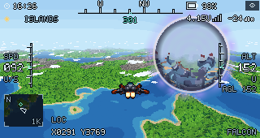
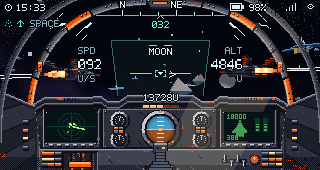
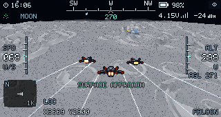

# Flight Club


Flight Club is a pixel flight game for Cardputer Zero. Pilot a fighter through wormholes to the other side of the world, fly from the surface into space, then approach a planet and land. Explore freely, race through checkpoints, collect coins, and fight aerial battles.

[简体中文](README_zh.md)

[](https://github.com/journey-ad/M5CardputerZero-FlightClub/actions/workflows/ci.yml)
[](LICENSE)
[](https://www.rust-lang.org)

## Gameplay

- Four modes: Free Flight, Checkpoint Race, Coin Rush, and Sky Assault
- Five aircraft with different speed, shields, weapons, and handling
- Ten surface maps, eight weather types, and day and night settings, with wormholes connecting the maps
- Seamless flight from the surface into space and back down to Earth or the Moon
- Motion controls, two wingmen, aerobatics, and a flight demonstration

## On-device screenshots

| Free Flight | Wormhole to the city |
| --- | --- |
|  |  |

| Checkpoint Race | Sky Assault |
| --- | --- |
|  |  |

| Space cockpit | Moon approach |
| --- | --- |
|  |  |

## Install on Cardputer Zero

The device build targets Linux ARM64. From the repository root, run:

```sh
rustup target add aarch64-unknown-linux-musl
bash scripts/build-cardputer.sh
python3 scripts/package-cardputer.py
```

This produces a static AArch64 binary at `dist/flight-club-cardputer` and an installable package at `dist/flight-club_0.29.12_arm64.deb`.

The packaging script uses a local `dpkg-deb` installation or runs it through Docker with `ubuntu:22.04`.

Copy the package to your Cardputer Zero and install it there:

```sh
sudo apt install ./flight-club_0.29.12_arm64.deb
```

Launch Flight Club from APPLaunch using the fighter icon.

## Device controls

The Cardputer Zero direction keys are F (up), X (down), Z (left), and C (right). Number keys have different functions in each mode.

### Menu and general controls

| Key | Action |
| --- | --- |
| F / X / Z / C | Select menu items or change settings |
| Enter | Confirm; continue or retry after a result |
| F1 | Open or close the controls guide |
| F2 | Open or close settings |
| F9 | Change the sound mode |
| Esc | Pause during flight or go back; hold for two seconds to quit |

### Flight controls in every mode

| Key | Action |
| --- | --- |
| F / X / Z / C | Climb, dive, turn left, turn right |
| Q / E | Roll left or right |
| Hold Shift | Boost |
| Space | Change camera view |
| W / A / S / D | Look up, left, down, right |
| Alt | Toggle hover |
| M | Open or close the map |
| I / K | Toggle motion controls or recalibrate |
| P / R | Pause or resume; retry the current level |

### Free Flight

| Key | Action |
| --- | --- |
| 1 | Change the weather |
| 2 | Change the time of day |
| 3 | Summon a wormhole ahead |
| 4 | Change aircraft |
| 5 | Change the number of wingmen |
| 6 | Toggle the exploded model view |
| 7 | Toggle autopilot |
| 8 | Toggle the flight demonstration |
| 9 | Change maps |
| 0 | Regenerate the current map with a new seed |

### Checkpoint Race

Use the shared flight controls. Press R to restart the level.

### Coin Rush

Use the shared flight controls. Press R to restart the level.

### Sky Assault

| Key | Action |
| --- | --- |
| Hold 1 | Fire |
| 2 | Change weapon |
| 3 | Launch NOVA |
| 4 | Activate overdrive |
| 5 | Toggle automatic fire |

### Map

| Key | Action |
| --- | --- |
| F / X / Z / C | Pan the map |
| 1 / 2 | Zoom in or out |
| 3 / 4 | Find the next wormhole or your aircraft |
| Space | Mark the crosshair position |
| Enter | Navigate to the marked position |
| M | Return to the previous screen |

See the [full controls guide (Chinese)](docs/controls.md) for every key.

### Motion controls

Hold the device still for about 0.8 seconds to calibrate. Press K to recalibrate after changing your grip.

- Tilt left and right to turn and bank
- Tilt forward and back to dive or climb; raising the top edge of the device makes the aircraft climb
- Press I to turn off motion controls and use the direction keys; releasing the keys holds the heading and gradually levels the aircraft
- Turning on autopilot with 7 also turns off motion controls

## Development and device diagnostics

The device build uses `glam` for scene math, writes RGB565 frames through fbdev mmap, and reads key press and release events through evdev. Runtime dependencies are statically linked into the executable.

The display path is read from `FLIGHT_CLUB_FB`, `APPLAUNCH_LINUX_FBDEV_DEVICE`, or `LV_LINUX_FBDEV_DEVICE`, then from `/dev/fb_lcd` or `/proc/fb`. The program validates screen size, RGB565 layout, and stride with ioctl. For the keyboard, set `FLIGHT_CLUB_KEYBOARD` or `APPLAUNCH_LINUX_KEYBOARD_DEVICE`; the default is the I²C keyboard's by-path device.

You can run a CPU benchmark or capture a fixed number of frames on the device:

```sh
flight-club-cardputer --benchmark 180 --scale 1 --capture-dir /tmp/flight-club-captures
flight-club-cardputer --mode combat --frames 300 --view cockpit --weather storm
flight-club-cardputer --mode race --vehicle 1 --level 3
flight-club-cardputer --mode combat --level 2 --view cockpit
flight-club-cardputer --mode combat --benchmark 180 --capture-dir /tmp/combat-check
flight-club-cardputer --map moon --mode free --view chase
flight-club-cardputer --map space --mode free --view cockpit
flight-club-cardputer --map space --benchmark 180 --capture-dir /tmp/space-check
flight-club-cardputer --map city --maneuvers 330 --capture-dir /tmp/flight-loops
flight-club-cardputer --map canyon --weather sandstorm --demo on
flight-club-cardputer --map alpine --seed 8082 --weather snow
flight-club-cardputer --imu-test 10 --imu-csv /tmp/flight-club-imu.csv
```

See [Project structure and development (Chinese)](docs/development.md) for build and verification details.

## Desktop preview

Run the desktop build to preview and debug the game:

```sh
cargo run --release
```

See the [full controls guide (Chinese)](docs/controls.md) for desktop keys.

## More documentation (Chinese)

- [Gameplay and aircraft](docs/gameplay.md): modes, aircraft, levels, and combat
- [Controls](docs/controls.md): device keys, motion controls, map, and desktop keys
- [Music and sound](docs/audio.md): synthesizer, tracks, and export
- [Rendering, HUD, and maps](docs/world.md): cockpit HUD, terrain, weather, and camera shots
- [Performance and rendering history](docs/performance.md): benchmarks across releases
- [Project structure and development](docs/development.md): repository layout, content settings, and verification

## Acknowledgment

Creative inspiration: https://remix.ui8.ai/fly

## License

Original code, documentation, and scripts are licensed under the [MIT License](LICENSE).

Third-party components and distribution notes are listed in [THIRD_PARTY_NOTICES.md](THIRD_PARTY_NOTICES.md).
