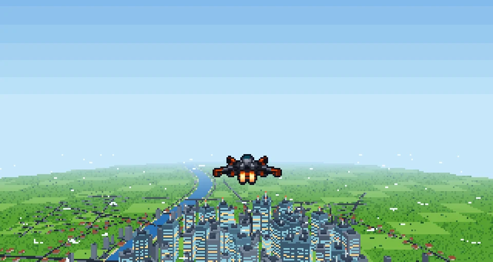
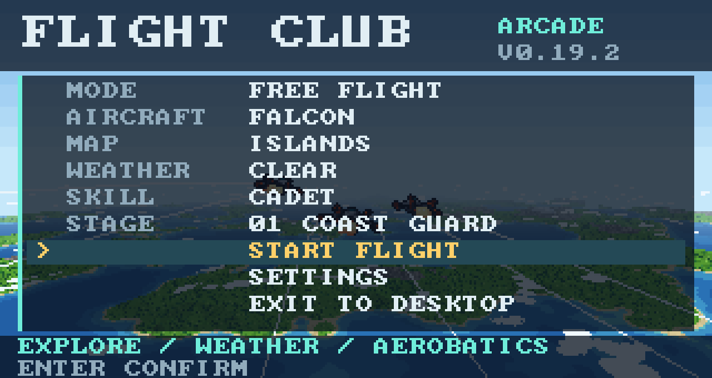
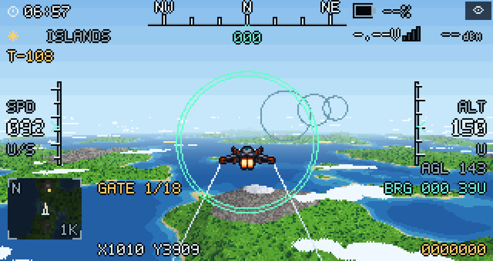
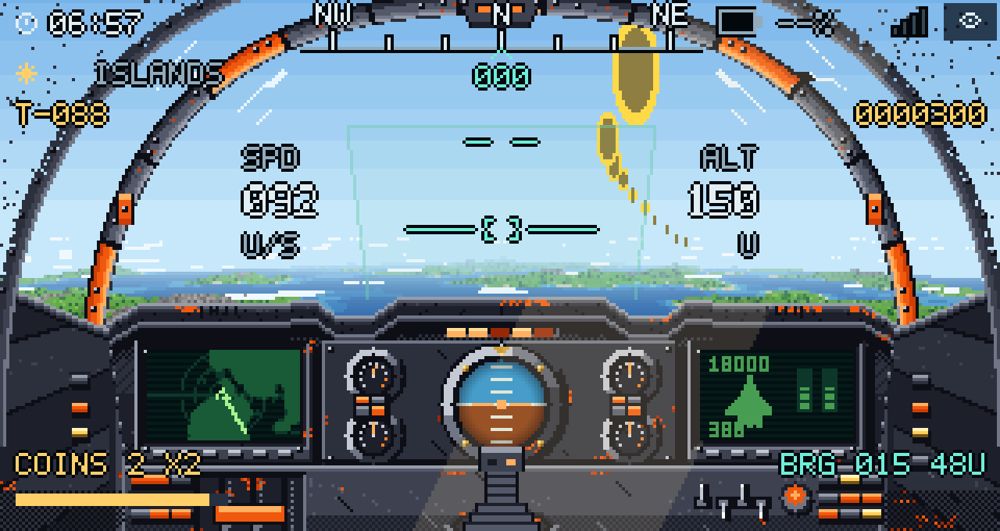
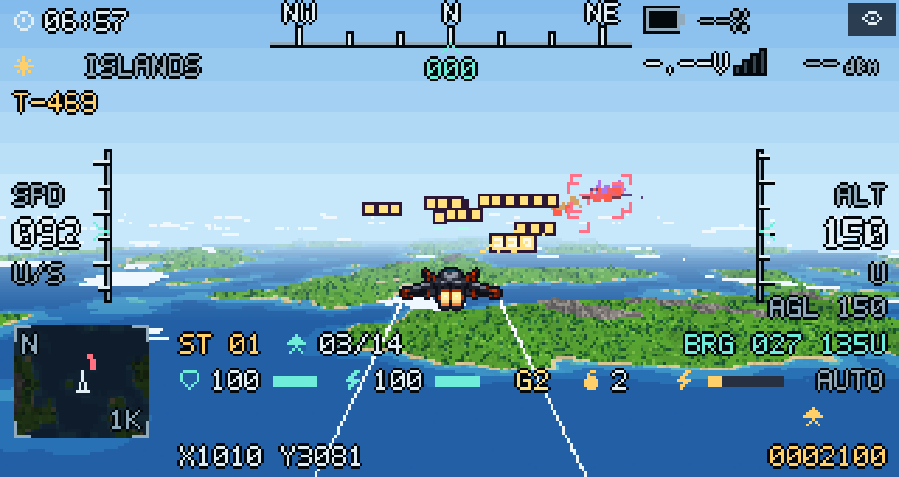
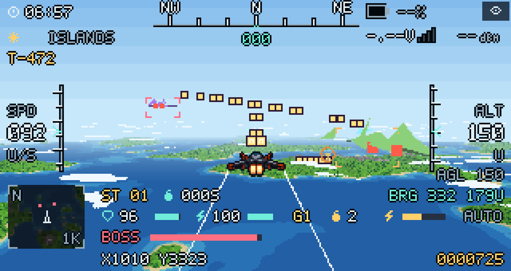
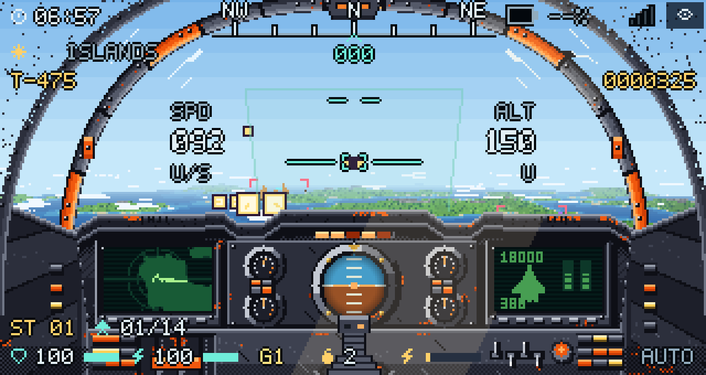
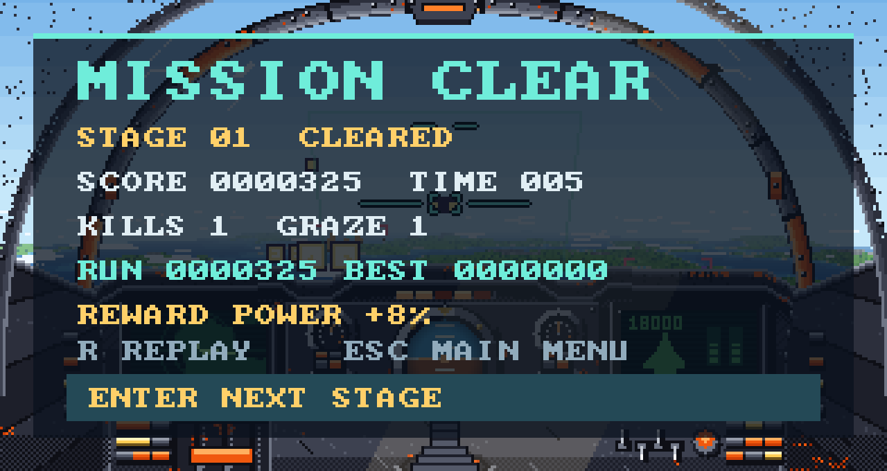
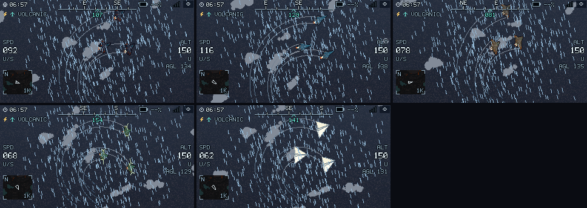
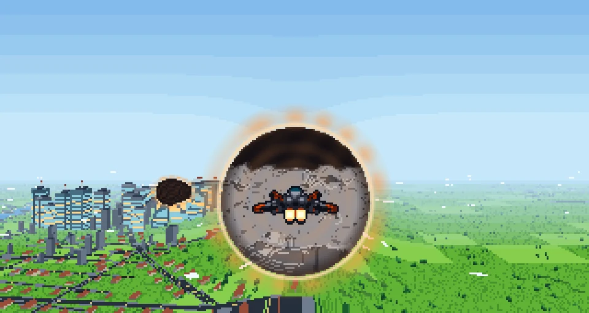

# Flight Club

[](https://github.com/journey-ad/M5CardputerZero-M5Flight/actions/workflows/ci.yml)
[](LICENSE)
[](https://www.rust-lang.org)

使用 Rust 实现的像素飞行场景，核心是 Sprite Stacking、高度图和 CPU 软件渲染。桌面版使用 macroquad 显示纹理，Cardputer Zero 版直接输出 RGB565 帧缓冲，渲染与游戏逻辑均由 Rust 实现



## 功能

- 四种模式：自由飞行、检查点竞速、金币冲刺、空战闯关
- 五种载具，速度、护盾、火力与操控各异
- 十类地表地图、八种天气、昼夜时段，虫洞连接多张地图
- Cardputer Zero 体感操控、编队僚机、特技动作与导演演示
- 实时合成的配乐与音效，无需外部音频文件

## 截图

| 主菜单 | 检查点竞速 |
| --- | --- |
|  |  |

| 金币冲刺 | 空战闯关 |
| --- | --- |
|  |  |

| Boss 战 | FPV 座舱 |
| --- | --- |
|  |  |

| 结算 | 五种载具 |
| --- | --- |
|  |  |

虫洞传送门循环



## 安装与运行

### 桌面版

```sh
cargo run --release
```

启动后显示主菜单和循环特技演示。模式、载具与关卡见 [玩法与载具](docs/gameplay.md)

### Cardputer Zero 设备版

```sh
rustup target add aarch64-unknown-linux-musl
bash scripts/build-cardputer.sh
python3 scripts/package-cardputer.py
sudo apt install ./dist/flight-club_*_arm64.deb
```

构建、安装与体感操作见 [设备版](docs/device.md)

## 操作

菜单用方向键选择，Enter 确认；桌面飞行用方向键控制俯仰与转向。常用键：

| 按键 | 功能 |
| --- | --- |
| 方向键 | 俯仰与转向 |
| Q / E | 横滚 |
| 空格 | 开火 |
| 4 | 超载 |
| M | 航图 |
| 8 | 导演演示 |
| F2 | 设置 |
| F9 | 声音模式 |

完整按键见 [操作说明](docs/controls.md)

## 文档

- [玩法与载具](docs/gameplay.md)：模式、载具、连续关卡与空战
- [操作说明](docs/controls.md)：桌面与设备按键、航图与体感
- [配乐与音效](docs/audio.md)：合成器、曲目与导出
- [渲染、HUD 与地图](docs/world.md)：FPV HUD、地形天气与演示镜头
- [设备版](docs/device.md)：Cardputer Zero 构建、安装与调试
- [性能基准与渲染记录](docs/performance.md)：历代性能基准
- [目录组织与内容配置](docs/development.md)：仓库结构、资源配置与验证
- [来源与复刻范围](docs/credits.md)：素材来源与许可

## 开发

Rust 2024 edition。桌面版依赖 macroquad 与 cpal，设备版交叉编译到 aarch64-unknown-linux-musl。构建、目录结构与验证见 [目录组织与内容配置](docs/development.md)

CI 在每次推送与合并请求运行格式检查、双特性单元测试、设备 musl 构建与三平台桌面打包；推送 `v*` 标签自动创建 GitHub Release，附带各平台二进制、设备 deb 与 SHA256SUMS

## 来源与致谢

战机与座舱美术来自公开参考页面，详情与许可范围见 [来源与复刻范围](docs/credits.md)

## 许可证

原创代码、文档与脚本使用 MIT 许可证，见 [LICENSE](LICENSE)。第三方组件与分发说明见 [THIRD_PARTY_NOTICES.md](THIRD_PARTY_NOTICES.md)
