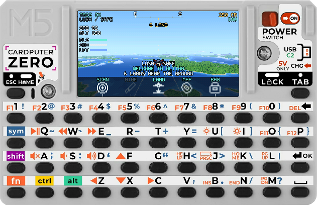
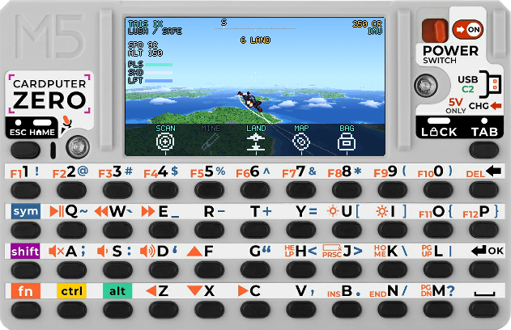
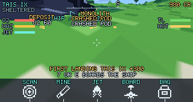
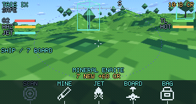
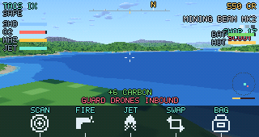
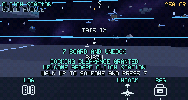
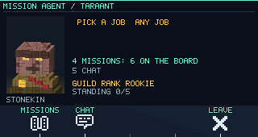
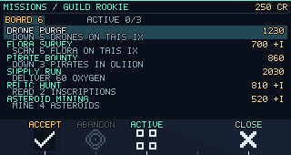
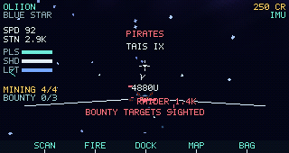
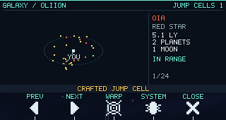

# Planet Zero

**Cardputer Sky: a procedural space exploration and survival game for the M5Stack Cardputer Zero.**

Fly a ship by tilting the device, land on generated planets, explore them on foot, mine and scan,
fight guard drones with randomly rolled weapons, walk aboard space stations to take work from the
people there, mine asteroids, fight off pirates, and warp across a galaxy of 14,260 star systems.
It runs on the Cardputer Zero's 320×170 screen with its keyboard and BMI270 gyroscope, fully
offline.

[简体中文](README_zh.md)

[](LICENSE)
[](https://www.rust-lang.org)



| Gyroscope banking | On foot beside the ship | Scanner |
| --- | --- | --- |
|  |  |  |

| Guard drones inbound | Aboard a station | Talking to the mission agent |
| --- | --- | --- |
|  |  |  |

| Mission board | Pirates inbound | Galaxy map |
| --- | --- | --- |
|  |  |  |

All screenshots come from the PC emulator, which runs the device build's own code.

## What you do

- **Fly by tilting.** Bank left and right to turn, raise the top edge to climb. Fly from a planet's
  surface straight up into space and back down to any planet in the system.
- **Land and explore on foot.** Seven biomes (lush, desert, frozen, toxic, volcanic, exotic and
  barren moons), each with its own terrain, colours, plants, minerals and hazard. First-person
  movement, a jetpack, and a tilt fine-aim.
- **Scan, mine and survive.** Scan plants and minerals for survey data, mine elements, keep life
  support and hazard protection up, and craft jump cells, hull patches and lift cells in a 16-slot
  inventory.
- **Fight.** Seven weapon types (mining beam, pulse laser, scatter blaster, rail lance, plasma
  mortar, arc caster, cryo beam), four rarities and sixteen random perks. Mining and shooting raise
  an alert that brings guard drones; weapon caches have guardians.
- **Walk aboard stations.** Docking puts you on foot in the hangar. Talk to the mission agent, the
  trader, the outfitter, the technician and a passing traveller; each is a voxel bust shaped by
  their species and dressed for their job.
- **Take missions.** Sixteen kinds (bounties, ace hunts, drone purges, surveys, relic hunts,
  asteroid mining, supply runs, couriers, scouting, rescues, long hauls and more), six offers per
  visit, three at a time, and a guild rank from ROOKIE to LEGEND that brings better-paid work.
- **Pirates and asteroids.** Raiders turn up every 30 minutes to 3 hours of flying, and bounty
  missions call their own. The ship's cannons lead their shots; key 5 mines the asteroid under the
  crosshair instead. Asteroid belts lie out past every station.
- **Warp.** Craft a jump cell, pick a star in range on the galaxy map and fly into the warp tunnel.
  Nothing is stored about the galaxy; every system comes from its coordinates.

Progress saves on its own (landing, take-off, docking, purchases, warps and every 45 seconds).

## Controls

The layout follows M5Stack's *Recommended Key Mapping Design*: the five most frequent actions sit on
keys **4–8** under the screen, with an icon over each key. The bar changes with what you are doing
and slides out of the way when you don't need it. **F / X / Z / C** are the arrow keys.

| Situation | 4 | 5 | 6 | 7 | 8 |
| --- | --- | --- | --- | --- | --- |
| Flying over a planet | SCAN | | LAND | MAP | BAG |
| Flying in space | SCAN | MINE or FIRE | DOCK (autopilot) | MAP | BAG |
| On foot | SCAN | FIRE (hold) | JET (hold) | BOARD / OPEN / READ / SIGNAL / SWAP | BAG |
| Aboard a station | LOG | | | TALK / UNDOCK | BAG |
| Talking to someone | SERVICE | CHAT | | | LEAVE |
| Mission board | ACCEPT / CLAIM | ABANDON | BOARD / ACTIVE | | CLOSE |

Tilt the device to steer the ship; hold Shift to boost. On foot the arrows walk and turn, and the
tilt fine-aims. Hold the device still for a moment to calibrate the gyroscope; K recalibrates and I
turns tilt steering off. F1 or H opens the help pages in the game. The full key list, gameplay
details and the save file format are in [the Cardputer Sky guide](docs/cardputer-sky.md).

## Install on Cardputer Zero

The device build targets Linux ARM64. From the repository root:

```sh
rustup target add aarch64-unknown-linux-musl
bash scripts/build-cardputer.sh
python3 scripts/package-cardputer.py
```

This produces a static AArch64 binary at `dist/flight-club-cardputer` and a package at
`dist/flight-club_0.42.3_arm64.deb` (the binary and package keep the engine's name). The packaging
script uses a local `dpkg-deb` or runs it in Docker with `ubuntu:22.04`. Copy the package to the
device and install it:

```sh
sudo apt install ./flight-club_0.42.3_arm64.deb
```

Launch it from APPLaunch. CARDPUTER SKY is the first entry in the menu and is selected by default.

## Play it on a PC

The emulator runs the device build's game object on your PC: the same key codes (including the
F/X/Z/C arrow remap), the same gyroscope fusion fed by a simulated BMI270, and the same RGB565
framebuffer. It plays a script, checks what happens, and saves screenshots framed in a picture of
the Cardputer Zero:

```sh
cargo run --release --no-default-features --features cardputer --bin flight-club-emulator
cargo run --release --no-default-features --features cardputer --bin flight-club-emulator -- --script scripts/emulator/station.txt --out target/emulator-station
```

Scripts in `scripts/emulator/`: `tour.txt` (a whole session, from the first landing to another star
system), `combat.txt` (first person, drones, weapons, caches), `station.txt` (missions, asteroid
mining and a pirate fight), `continue.txt` (save and resume) and `video.txt`. Add
`--video FILE.mp4` to record gameplay with sound (needs `ffmpeg`).

To play with a window and a keyboard, run the desktop build with `cargo run --release`.

## Development

```sh
cargo fmt --all -- --check
cargo clippy --all-features --all-targets -- -D warnings
cargo test --locked                                              # desktop feature set
cargo test --locked --no-default-features --features cardputer   # device feature set
```

Game logic lives in `src/sky/` (no rendering), engine glue in `src/app/sky.rs`,
`src/app/sky_foot.rs` and `src/app/sky_space.rs`, and drawing in `src/ui/sky.rs`. 3D additions go
through the engine's software renderer as extra triangles. See
[the architecture notes](docs/sky-architecture.md) for how the game fits the engine, version by
version.

## Built on Flight Club

Planet Zero is a fork of [Flight Club](https://github.com/journey-ad/M5CardputerZero-FlightClub) by
journey-ad, a pixel flight game for the Cardputer Zero with a CPU software renderer, procedural
terrain, wormholes and seamless flight from the surface to space. Cardputer Sky reuses its renderer,
terrain, flight model, space and orbit transitions, synthesizer and device layer.

Flight Club's own four modes (Free Flight, Checkpoint Race, Coin Rush and Sky Assault) are still in
the menu. Their controls and documentation (mostly in Chinese) are in
[docs/controls.md](docs/controls.md), [docs/gameplay.md](docs/gameplay.md) and the rest of
[docs/](docs/).

## License

Original code, documentation, and scripts are licensed under the [MIT License](LICENSE), as is the
Flight Club engine it builds on. Third-party components and distribution notes are listed in
[THIRD_PARTY_NOTICES.md](THIRD_PARTY_NOTICES.md).
