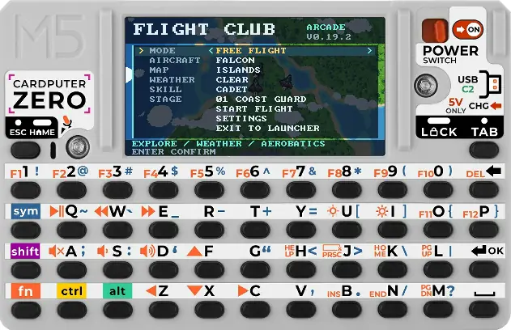
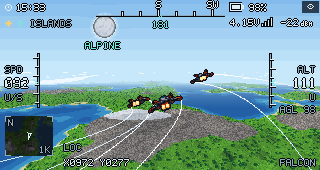
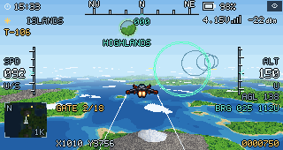
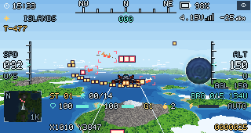

# Flight Club



[English](README.md)

Flight Club 是为 Cardputer Zero 制作的像素飞行游戏。驾驶战机穿越虫洞，到达世界的另一端，从地表飞向宇宙，再驶向星球降落。自由探索、竞速、金币冲刺与空战。

[](https://github.com/journey-ad/M5CardputerZero-FlightClub/actions/workflows/ci.yml)
[](LICENSE)
[](https://www.rust-lang.org)

## 玩法

- 自由飞行、检查点竞速、金币冲刺和空战闯关四种模式
- 五种载具，速度、护盾、火力与操控各异
- 十类地表地图、八种天气与昼夜时段，虫洞连接多张地图
- 无缝起降，从地表冲向太空、或是在月球上降落
- 陀螺仪体感操控、双僚机、特技动作演示

## 设备画面

| 自由飞行 | 虫洞穿梭 |
| --- | --- |
|  |  |

| 检查点竞速 | 空战闯关 |
| --- | --- |
|  |  |

| 太空座舱 | 月球着陆 |
| --- | --- |
|  |  |

## 安装到 Cardputer Zero

设备版面向 Linux ARM64 的 Cardputer Zero，在根目录构建：

```sh
rustup target add aarch64-unknown-linux-musl
bash scripts/build-cardputer.sh
python3 scripts/package-cardputer.py
```

构建得到静态 AArch64 可执行文件 `dist/flight-club-cardputer` 和安装包 `dist/flight-club_0.31.2_arm64.deb`

打包工具使用本机 `dpkg-deb`，或通过 Docker 在 `ubuntu:22.04` 中运行

将安装包复制到设备，在设备上执行：

```sh
sudo apt install ./flight-club_0.31.2_arm64.deb
```

安装后从 APPLaunch 选择带战机图标的 Flight Club 启动

## 设备操作

Cardputer Zero 的方向键为 F（上）、X（下）、Z（左）、C（右）。数字键的功能随玩法变化

### 菜单与通用操作

| 按键 | 功能 |
| --- | --- |
| F / X / Z / C | 选择菜单项或调整设置 |
| Enter | 确认选项；结算后继续或重试 |
| F1 | 打开或关闭操作说明 |
| F2 | 打开或关闭设置 |
| F9 | 切换声音模式 |
| Esc | 飞行中暂停；在其他页面返回；长按 2 秒退出游戏 |

### 通用飞行操作

| 按键 | 功能 |
| --- | --- |
| F / X / Z / C | 拉升、俯冲、左转、右转 |
| Q / E | 左横滚、右横滚 |
| 按住 Shift | 加速 |
| 空格 | 切换视角 |
| W / A / S / D | 向上、左、下、右观察 |
| Alt | 切换悬停 |
| M | 打开或关闭航图 |
| I / K | 开关体感、重新校准体感 |
| P / R | 暂停或继续、重试当前关卡 |

### 自由飞行

| 按键 | 功能 |
| --- | --- |
| 1 | 切换天气 |
| 2 | 切换时段 |
| 3 | 在前方生成虫洞 |
| 4 | 切换载具 |
| 5 | 切换僚机数量 |
| 6 | 开启或关闭模型展开 |
| 7 | 开启或关闭自动巡航 |
| 8 | 开启或关闭导演演示 |
| 9 | 切换地图 |
| 0 | 用新种子生成当前地图 |

### 检查点竞速

使用通用飞行操作，按 R 重试当前关卡

### 金币冲刺

使用通用飞行操作，按 R 重试当前关卡

### 空战闯关

| 按键 | 功能 |
| --- | --- |
| 按住 1 | 开火 |
| 2 | 切换武器 |
| 3 | 释放 NOVA |
| 4 | 激活超载 |
| 5 | 开启或关闭自动开火 |

### 航图

| 按键 | 功能 |
| --- | --- |
| F / X / Z / C | 平移航图 |
| 1 / 2 | 放大、缩小航图 |
| 3 / 4 | 定位下一个虫洞、定位飞机 |
| 空格 | 标记十字位置 |
| Enter | 自动导航到标记位置 |
| M | 返回之前的页面 |

完整键位见 [操作说明](docs/controls.md)

### 体感操控

握住设备，保持静止约 0.8 秒完成校准，按 K 重新校准

- 左右倾斜控制转向和侧倾
- 前后倾斜控制俯仰，抬起设备上缘为拉升
- 按 I 关闭体感后可使用实体键，松开操纵键时保持航向并逐渐恢复水平姿态
- 按 7 开启自动巡航时会关闭体感

## 开发与真机调试

设备版使用 `glam` 计算场景，通过 fbdev mmap 写入 RGB565，通过 evdev 接收完整的按下与松开事件；运行时依赖静态链接在可执行文件中

屏幕路径依次读取 `FLIGHT_CLUB_FB`、`APPLAUNCH_LINUX_FBDEV_DEVICE`、`LV_LINUX_FBDEV_DEVICE`，然后尝试 `/dev/fb_lcd` 或扫描 `/proc/fb`。打开屏幕后通过 ioctl 校验尺寸、RGB565 位布局与 stride。键盘支持 `FLIGHT_CLUB_KEYBOARD`、`APPLAUNCH_LINUX_KEYBOARD_DEVICE`，默认读取 I²C 键盘的 by-path 节点

设备上可独立运行 CPU 基准，也可限定帧数检查实际显示：

```sh
flight-club-cardputer --benchmark 180 --scale 1 --capture-dir /tmp/flight-club-captures
flight-club-cardputer --mode combat --frames 300 --view cockpit --weather storm
flight-club-cardputer --mode race --vehicle 1 --level 3
flight-club-cardputer --mode combat --level 2 --view cockpit
flight-club-cardputer --mode combat --benchmark 180 --capture-dir /tmp/combat-check
flight-club-cardputer --map moon --mode free --view chase
flight-club-cardputer --map space --mode free --view cockpit
flight-club-cardputer --map space --benchmark 180 --capture-dir /tmp/space-check
flight-club-cardputer --map city --maneuvers 330 --capture-dir /tmp/flight-loops
flight-club-cardputer --map canyon --weather sandstorm --demo on
flight-club-cardputer --map alpine --seed 8082 --weather snow
flight-club-cardputer --imu-test 10 --imu-csv /tmp/flight-club-imu.csv
```

构建、目录结构与验证见 [目录组织与内容配置](docs/development.md)

## 桌面预览

桌面版可用于预览和调试：

```sh
cargo run --release
```

桌面飞行完整键位见 [操作说明](docs/controls.md)

## 详细说明

- [玩法与载具](docs/gameplay.md)：模式、载具、连续关卡与空战
- [操作说明](docs/controls.md)：设备按键、体感、航图与桌面键盘
- [配乐与音效](docs/audio.md)：合成器、曲目与导出
- [渲染、HUD 与地图](docs/world.md)：FPV HUD、地形天气与演示镜头
- [性能基准与渲染记录](docs/performance.md)：历代性能基准
- [目录组织与内容配置](docs/development.md)：仓库结构、资源配置与验证

## 致谢

创意来源 https://remix.ui8.ai/fly

## 许可证

原创代码、文档与脚本使用 MIT 许可  [LICENSE](LICENSE)

第三方组件与分发说明见 [THIRD_PARTY_NOTICES.md](THIRD_PARTY_NOTICES.md)
