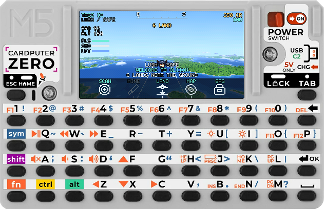
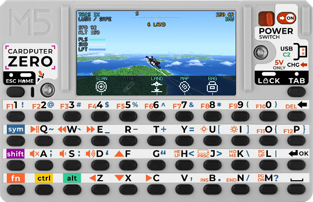
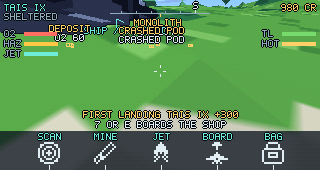
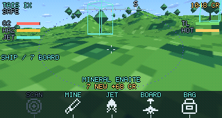
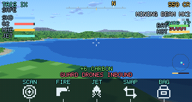
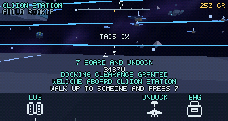
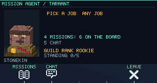
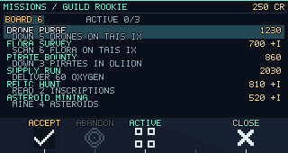
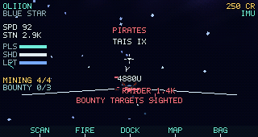
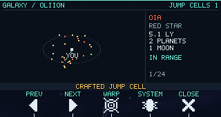

# Planet Zero

**Cardputer Sky：为 M5Stack Cardputer Zero 打造的程序生成太空探索与生存游戏。**

倾斜设备驾驶飞船，降落在程序生成的行星上步行探索，采矿与扫描，用随机词条的武器对抗守卫无人机，登上空间站向站内人物接取任务，开采小行星、击退海盗，并在 14,260 个星系之间跃迁。游戏运行在 Cardputer Zero 的 320×170 屏幕上，使用设备键盘与 BMI270 陀螺仪，完全离线。

[English](README.md)

[](LICENSE)
[](https://www.rust-lang.org)



| 陀螺仪压坡度转弯 | 在飞船旁步行 | 扫描仪 |
| --- | --- | --- |
|  |  |  |

| 守卫无人机来袭 | 登上空间站 | 与任务代理交谈 |
| --- | --- | --- |
|  |  |  |

| 任务板 | 海盗来袭 | 星系图 |
| --- | --- | --- |
|  |  |  |

所有截图来自 PC 模拟器，运行的是设备版本本身的代码。

## 玩法

- **倾斜飞行。** 左右倾斜转弯，抬起设备上沿爬升。从行星地表直接飞入太空，再降落到星系内任意行星。
- **降落与步行探索。** 七种生态（繁茂、沙漠、冰冻、毒性、火山、奇异与荒芜卫星），各有地形、配色、植物、矿物与环境危害。第一人称移动、喷气背包与倾斜微调瞄准。
- **扫描、采矿与生存。** 扫描植物与矿物获取勘测数据，开采元素，维持生命维持与危害防护，在 16 格背包中合成跃迁电池、船体补丁与升力电池。
- **战斗。** 七类武器（采矿光束、脉冲激光、散射炮、轨道长枪、等离子迫击炮、电弧发射器、冷冻光束）、四档稀有度与十六种随机词条。采矿与开火会提高警戒，引来守卫无人机；武器箱有守卫看护。
- **登上空间站。** 对接后在机库中步行，与任务代理、商人、军械商、技师以及过路旅人交谈；每个人都是按种族塑形、按职业着装的体素半身像。
- **接取任务。** 十六类任务（悬赏、王牌猎杀、清剿无人机、勘测、遗迹搜寻、小行星采矿、补给、快递、侦察、救援、长途运输等），每次停靠六份委托，最多同时进行三项；公会等级从 ROOKIE 升到 LEGEND，带来报酬更高的工作。
- **海盗与小行星。** 每飞行 30 分钟到 3 小时会遭遇一次海盗袭击，悬赏任务会召来专属目标。飞船机炮自动提前量瞄准；准星对准小行星时 5 键改为采矿。小行星带位于每座空间站外侧。
- **跃迁。** 合成跃迁电池，在星系图上选择航程内的恒星，飞入跃迁隧道。星系不存储任何数据，每个星系都由坐标生成。

进度会自动保存（降落、起飞、对接、购买、跃迁及每 45 秒）。

## 操作

按键布局遵循 M5Stack 推荐的按键映射设计：五个最常用操作位于屏幕下方的 **4–8** 键，每个键上方显示图标。按键栏随当前状态变化，不需要时自动收起。**F / X / Z / C** 为方向键。

| 状态 | 4 | 5 | 6 | 7 | 8 |
| --- | --- | --- | --- | --- | --- |
| 行星上空飞行 | 扫描 | | 降落 | 地图 | 背包 |
| 太空飞行 | 扫描 | 采矿或开火 | 对接（自动驾驶） | 地图 | 背包 |
| 步行 | 扫描 | 开火（按住） | 喷气（按住） | 登船 / 打开 / 阅读 / 信号 / 切换 | 背包 |
| 空间站内 | 任务日志 | | | 交谈 / 离港 | 背包 |
| 交谈中 | 服务 | 闲聊 | | | 离开 |
| 任务板 | 接受 / 领取 | 放弃 | 任务板 / 进行中 | | 关闭 |

倾斜设备驾驶飞船，按住 Shift 加速。步行时方向键移动与转身，倾斜用于微调瞄准。保持设备静止片刻完成陀螺仪校准；K 重新校准，I 关闭倾斜操控。游戏内按 F1 或 H 打开帮助。完整按键、玩法细节与存档格式见 [Cardputer Sky 指南（英文）](docs/cardputer-sky.md)。

## 安装到 Cardputer Zero

设备版本面向 Linux ARM64。在仓库根目录运行：

```sh
rustup target add aarch64-unknown-linux-musl
bash scripts/build-cardputer.sh
python3 scripts/package-cardputer.py
```

生成静态 AArch64 可执行文件 `dist/flight-club-cardputer` 和安装包 `dist/flight-club_0.42.3_arm64.deb`（可执行文件与安装包沿用引擎名称）。打包脚本使用本机 `dpkg-deb`，或通过 Docker 的 `ubuntu:22.04` 运行。将安装包复制到设备后安装：

```sh
sudo apt install ./flight-club_0.42.3_arm64.deb
```

从 APPLaunch 启动。CARDPUTER SKY 是菜单第一项，默认选中。

## 在 PC 上运行

模拟器在 PC 上运行设备版本的游戏对象：相同的按键码（包括 F/X/Z/C 方向键映射）、由模拟 BMI270 驱动的同一套陀螺仪融合，以及相同的 RGB565 帧缓冲。它执行脚本、检查结果，并把截图保存在 Cardputer Zero 外观图中：

```sh
cargo run --release --no-default-features --features cardputer --bin flight-club-emulator
cargo run --release --no-default-features --features cardputer --bin flight-club-emulator -- --script scripts/emulator/station.txt --out target/emulator-station
```

`scripts/emulator/` 中的脚本：`tour.txt`（从首次降落到另一个星系的完整流程）、`combat.txt`（第一人称、无人机、武器、武器箱）、`station.txt`（任务、小行星采矿与海盗战斗）、`continue.txt`（存档与读档）和 `video.txt`。加上 `--video FILE.mp4` 可录制带声音的游戏视频（需要 `ffmpeg`）。

如需窗口与键盘游玩，运行桌面版本 `cargo run --release`。

## 开发

```sh
cargo fmt --all -- --check
cargo clippy --all-features --all-targets -- -D warnings
cargo test --locked                                              # 桌面功能集
cargo test --locked --no-default-features --features cardputer   # 设备功能集
```

游戏逻辑位于 `src/sky/`（不含渲染），引擎衔接位于 `src/app/sky.rs`、`src/app/sky_foot.rs` 与 `src/app/sky_space.rs`，绘制位于 `src/ui/sky.rs`。3D 内容以额外三角形的形式交给引擎的软件渲染器。游戏与引擎的结合方式及各版本说明见 [架构说明（英文）](docs/sky-architecture.md)。

## 基于 Flight Club

Planet Zero 派生自 journey-ad 的 [Flight Club](https://github.com/journey-ad/M5CardputerZero-FlightClub)：一款为 Cardputer Zero 制作的像素飞行游戏，拥有 CPU 软件渲染器、程序生成地形、虫洞以及从地表到太空的无缝飞行。Cardputer Sky 复用了它的渲染器、地形、飞行模型、太空与轨道过渡、合成器与设备层。

Flight Club 原有的四种模式（自由飞行、检查点竞速、金币冲刺、空战闯关）仍保留在菜单中，其操作与文档见 [docs/controls.md](docs/controls.md)、[docs/gameplay.md](docs/gameplay.md) 及 [docs/](docs/) 下的其他文档。

## 许可证

原创代码、文档和脚本采用 [MIT 许可证](LICENSE)，所依托的 Flight Club 引擎同样采用 MIT 许可证。第三方组件及分发说明见 [THIRD_PARTY_NOTICES.md](THIRD_PARTY_NOTICES.md)。
