# Cardputer Sky

Cardputer Sky is a procedural space exploration and survival mode for the Cardputer Zero, built on
the Flight Club engine in this repository. Fly a ship with the gyroscope, land on generated planets,
explore them on foot, scan and mine, fight guard drones with procedurally rolled weapons, survive the
planets' hazards, walk aboard space stations to trade and take missions from their people, mine
asteroids and fight pirates with the ship, and warp across a galaxy of 14,260 star systems.

It is the first entry in the main menu (MODE: CARDPUTER SKY). The other four Flight Club modes are
unchanged.

| Flying over a lush world | Gyroscope banking | On foot beside the ship |
| --- | --- | --- |
| 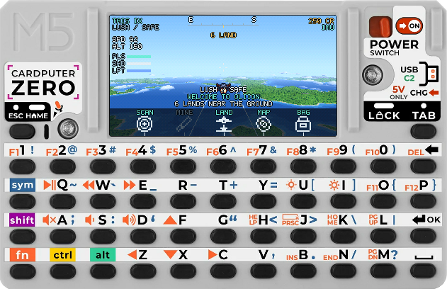 | 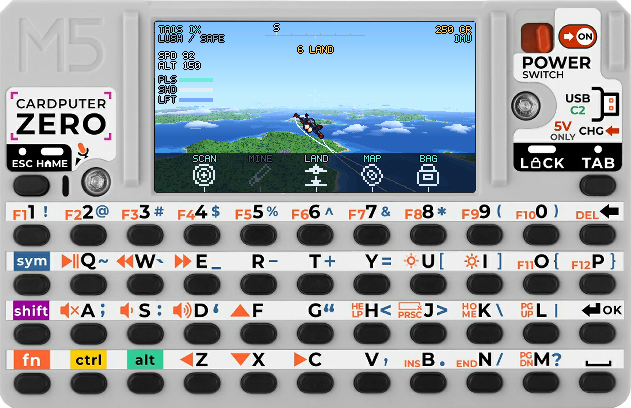 | 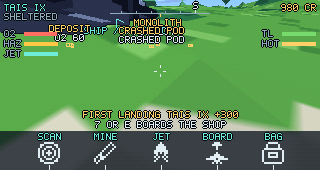 |

| Scanner | Mining | Frozen planet in another system |
| --- | --- | --- |
| 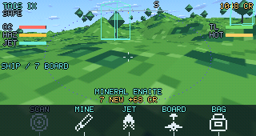 | 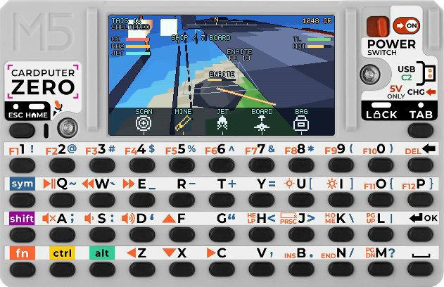 | 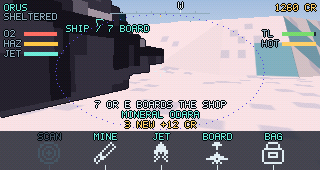 |

| Inventory | Crafting | Station |
| --- | --- | --- |
| 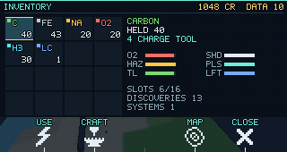 | 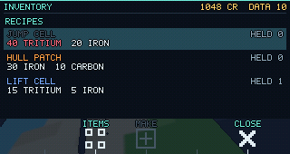 | 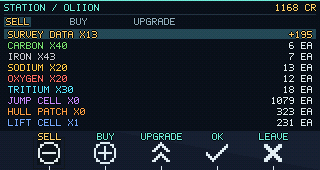 |

| Galaxy map | System map | Help |
| --- | --- | --- |
| 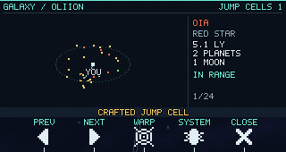 | 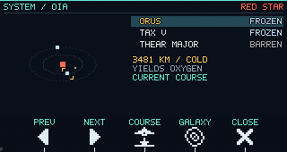 | 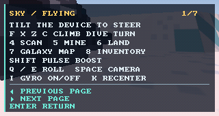 |

| Guard drones inbound | Weapon cache | Weapons view |
| --- | --- | --- |
| 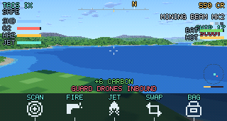 | 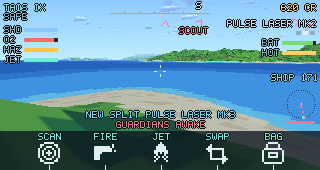 | 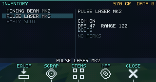 |

| Drone down | Station armory | Aboard a station |
| --- | --- | --- |
| 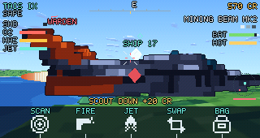 | 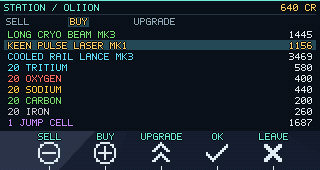 | 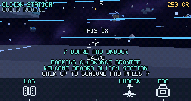 |

| Talking to the mission agent | Mission board | Pirates inbound |
| --- | --- | --- |
| 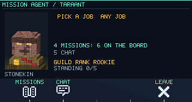 | 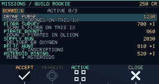 | 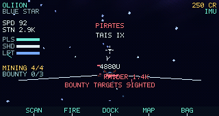 |

All screenshots come from the PC emulator described below.

## Controls

The layout follows M5Stack's *Recommended Key Mapping Design*: the five most frequent actions sit on
keys **4–8**, directly under the screen, with a 22×22 icon centred over each key (x = 49, 105, 161,
217, 273; y = 153) and a short tick pointing down at it. The bar changes with what you are doing.
**F / X / Z / C** are always the arrow keys; Cardputer Sky never asks for text, so they never type.
Other keys are listed only in the help pages (F1 or H), never in columns that line up with keys 4–8.

On the HUD the bar keeps out of the way: after 2.5 seconds without a key press it slides down until
only the labels and the ticks to the keys show, and any key press slides it back up. A pressed key
flashes bright and stays gold while held (its icon sinks a pixel like a real button); a key whose
action is unavailable right now flashes red instead. Panels always show the full bar.

| Situation | 4 | 5 | 6 | 7 | 8 |
| --- | --- | --- | --- | --- | --- |
| Flying over a planet | SCAN | MINE (space only) | LAND | MAP | BAG |
| Flying in space | SCAN | MINE (rock under the crosshair) or FIRE cannons | DOCK (autopilot) | MAP | BAG |
| Aboard a station | LOG (missions) | | | TALK / UNDOCK (on the pad) | BAG |
| Talking to someone | MISSIONS / TRADE / BUY / UPGRADES / ASK | CHAT | | | LEAVE |
| Mission board | ACCEPT / CLAIM | ABANDON | BOARD / ACTIVE | | CLOSE |
| On foot | SCAN | FIRE (hold) | JET (hold) | BOARD / OPEN / READ / SIGNAL / SWAP | BAG |
| Galaxy map | PREV | NEXT | WARP | SYSTEM | CLOSE |
| System map | PREV | NEXT | COURSE | GALAXY | CLOSE |
| Inventory | USE | CRAFT | ARMS | MAP | CLOSE |
| Weapons view | EQUIP | SCRAP | ITEMS | MAP | CLOSE |
| Recipes | | ITEMS | MAKE | | CLOSE |
| Inscription | | | | | CLOSE |
| Station | SELL | BUY | UPGRADE | OK | UNDOCK |

**Piloting.** Tilt the device to fly: roll it to bank and turn, raise its top edge to climb. The
gyroscope calibrates when you hold the device still for a moment; **K** recentres it and **I** turns it
off (the arrow keys then fly the ship). The gyroscope steers only the ship: it is ignored on foot, in
panels and while the autopilot docks. **Shift** is the pulse boost, **Q / E** roll, **Space** changes
the camera, **Alt** hovers, **M** opens the navigation chart.

**On foot.** F / X walk forward and back, Z / C turn, A / D step sideways, W / S look up and down,
Shift runs, Space or 6 fires the jetpack. Turning is gentle at first so a tap aims precisely, then
speeds up while held; a double tap of X turns you around; after a moment without looking up or down
the view levels itself. Small tilts of the device fine-aim the view (about ±12° across, ±9° up and
down) around how you held it when you landed; K recentres. While you fire, aim assist eases the view
onto a drone or minable prop near the crosshair. Both can be switched off in F2 settings (AIM ASSIST,
TILT AIM ON FOOT). Key **7** (or E) does what fits where you stand, and its icon says so: BOARD next
to the ship, OPEN a pod or cache, READ a monolith or ruin, SIGNAL at a beacon, otherwise SWAP to your
next weapon (Q also swaps).

**Everywhere.** F1 or H help, Tab inventory, G galaxy map, V scan, L land, Esc closes a panel (or
pauses), hold Esc for two seconds to save and quit.

## How a session goes

1. You start flying low over the first planet of your home system. Press **6** near the ground to
   land: the ship settles on the nearest flat, dry spot ahead and you step out beside it. A beacon
   marks the ship whenever you walk away.
2. **Scan** (4) sends out a wave. Flora, minerals and points of interest in range get a wireframe
   frame with their name and yield; each new find pays credits and survey data. From the air the
   scanner marks only points of interest: monoliths, crashed pods and rich deposits.
3. **Mine** (hold 5) with the crosshair on a prop: flora gives carbon, rocks give iron, crystals and
   deposits give the planet's own element. The tool heats up (let it cool) and uses charge (carbon).
   Crashed pods crack open for supplies.
4. **Survive.** Life support (oxygen) runs down slowly everywhere; hazardous planets (heat, cold,
   toxicity, radiation) drain your hazard protection (sodium) first, then life support six times faster.
   Standing next to your ship shelters you. If life support runs out you wake up at the ship having
   lost a third of your elements. The jetpack recharges on the ground.
5. **Leave.** Board with 7 (take-off uses a quarter of the lift fuel, refilled with tritium or a lift
   cell), then tilt the nose up and hold boost to climb to orbit.
6. **In space**, press 6 to fly to the station on autopilot (it steers around planets). Key 5 mines
   the asteroid under the crosshair and fires the ship's cannons otherwise. Fly at a planet to
   descend to it.
7. **Aboard the station** you land in the hangar and walk. Walk up to someone and press 7 to talk:
   the trader buys survey data and elements and sells fuel, elements and items; the outfitter runs
   the armory; the technician repairs the shield and sells upgrades (pulse drive, warp range, mining
   beam, hazard shield, suit shield, jetpack; three levels each); the mission agent has the board;
   a traveller passing through sometimes has a gift or a rumour. Walk back to the pad and press 7 to
   undock.
8. **Warp.** Craft a jump cell (40 tritium + 20 iron) in the inventory, open the galaxy map (7), pick
   a star in range (cyan) and press 6. A warp tunnel opens ahead; fly into it. The jump uses the
   engine's own wormhole, with the destination visible through the aperture.
9. In a new system, open the system map (7, then 7) to see its planets and set a course (6): the
   chosen planet becomes the one you can fly down to. Your progress saves on landing, take-off,
   docking, purchases, warps and every 45 seconds.

## Weapons

You start with a mining beam and a pulse laser. Every other weapon is rolled from a seed:

| Archetype | How it fires |
| --- | --- |
| Mining beam | continuous beam, the best at mining |
| Pulse laser | rapid bolts |
| Scatter blaster | 5 or more pellets, short range |
| Rail lance | slow, instant, pierces every drone in line |
| Plasma mortar | ballistic round that lands where you aim and bursts |
| Arc caster | lightning that jumps to more drones |
| Cryo beam | continuous beam that slows drones |

Rarity (common, uncommon, rare, exotic) gives 0–3 perks and better rolls, and colours the name. The 16
perks: Overclocked, Heat Sink, Long Barrel, Splitter, Ricochet, Piercing, Volatile, Chain, Prospector,
Efficient, Cryo Rounds, Siphon, Crit Lens, Homing, Salvager, Stabilized. The weapons view lists each
weapon's perks with what they do, and the HUD shows their letters. The first perk names the weapon
("SPLIT PULSE LASER MK3"). You carry three weapons and keep six in the locker (inventory, then 6 ARMS:
4 equips, 5 scraps a weapon for iron and carbon). Every weapon uses the battery (charge it with
carbon) and has its own heat; an overheated weapon locks for a few seconds, so swap.

Weapons come from crashed pods (sometimes), weapon caches (always rare or better), destroyed drones
(more often at high alert), station armories (three new weapons at every docking), pirate aces and
mission rewards. A reroll cell (drone core + 30 tritium + 20 sodium) rerolls the active weapon's perks.

## Guard drones

Mining, opening caches and shooting raise the **alert** (the meter under the radar); it fades after a
quiet spell. Past a third, patrols fly in from beyond the horizon: SCOUTs (fast, weak), WARDENs
(armoured; the red "!" over a drone means it is about to fire) and HIVEs (slow, launching scouts). At
most four come at once. They circle at their own range and fire only with a clear line of sight, so
terrain is cover. Their bolts hit your **suit shield** (SHD) first, which recharges three seconds
after the last hit; what gets through drains life support. Opening a weapon cache always wakes its
guardians. Destroyed drones drop credits, iron, carbon, drone cores and sometimes weapons. The 30 px
radar shows the ship, drones, marked points of interest and scanned props, with forward up.

## Places

Points of interest are monoliths and ruins (READ an inscription for survey data, sometimes a reroll
cell), crashed pods and weapon caches (OPEN), rich deposits (mine), and beacons (SIGNAL marks every
point of interest within 600 units on your HUD and radar).

## Stations and missions

Docking puts you on foot in the station's hangar, beside your ship on the landing pad. Each station
is run by one of three species (tall crested TALLFOLK, broad STONEKIN, or floating LANTERNS) and has
five people: a mission agent, a trader, an outfitter, a technician and a traveller who walks the
hangar. Talking shows the person as a voxel bust that turns as they speak, shaped by species and
dressed by role (the agent's guild badge and sash, the trader's satchel, the outfitter's plated
shoulders, the technician's goggles, the traveller's scarf). Press 5 while talking for small talk.

The **mission agent** keeps a board of six offers, new at every visit. You can run three missions at
once (key 4 aboard opens your log); progress is tracked on the HUD, and any station's agent pays out.
There are sixteen kinds:

| Mission | What to do |
| --- | --- |
| PIRATE BOUNTY | Down raiders; they come for you once you leave the station |
| HUNT THE ACE | Down a named pirate ace in a heavier ship, with escorts |
| DRONE PURGE | Destroy guard drones on any planet |
| FLORA SURVEY / MINERAL SURVEY | Scan plants or minerals on a named planet |
| RELIC HUNT | Read inscriptions at monoliths and ruins |
| ASTEROID MINING | Break asteroids with the ship |
| SUPPLY RUN | Bring elements to the station |
| DRONE SALVAGE | Bring drone cores |
| COURIER | Carry a package to a station in another system |
| SCOUTING | Visit systems you have never seen |
| LANDFALL | Land on a named planet |
| CACHE RAID | Open weapon caches |
| BEACON NETWORK | Signal beacons |
| RESCUE | Open crashed pods for survivors' logs |
| LONG HAUL | Deliver a large load of a rare element far away |

Rewards are credits plus, sometimes, items or a weapon; harder tiers pay more. Every mission done
raises your **guild standing**: ROOKIE, FREELANCER (5), VETERAN (15), ACE (35) and LEGEND (70).
Each rank brings harder, better-paid offers.

## Pirates and asteroids

Pirate raids are rare: one comes every 30 minutes to 3 hours of flying (never near a station, and the
timer is kept in your save). Bounty and ace missions call their own targets about 20 seconds after
you leave the station. Raiders dive at you, fire when lined up and break off to come round again;
the cannons (5 when no asteroid is under the crosshair) lead their shots and nudge toward a raider
within about 20 degrees of the nose, and overheat if held too long. Pirate bolts hit the ship's
shield; if it fails, the ship is towed to the station and a third of the cargo is lost. Downed
raiders pay credits and tritium, sometimes a weapon; an ace always drops a rare weapon.

Asteroid belts lie out past each station. Common rocks give tritium and iron, rich ones (blue veins)
more tritium and sodium, rare ones (gold veins) credits and iron. Mined rocks grow back after five
minutes.

## The universe

* **Galaxy:** a 97 × 97 × 13 grid of cells, denser in the core and along two spiral arms. A system
  exists where a hash of its coordinates falls under the local density, so nothing is stored.
* **Star systems:** yellow, red, green or blue star (each tints the light); one to four planets plus
  one airless moon; a space station; an asteroid ring of 26–43 rocks; syllable-generated names.
* **Biomes:** Lush (safe), Desert (heat), Frozen (cold), Toxic, Volcanic (strong heat), Exotic
  (radiation) and Barren moons (radiation, no air). Each uses one of the engine's terrain archetypes
  with the planet's own seed, its own colour grade for sky, fog and ground, its own prop colours and
  densities, and its own mineral (oxygen, sodium or tritium).
* **Elements:** carbon (tool charge), iron (shield), sodium (hazard protection), oxygen (life
  support), tritium (pulse drive, lift fuel, jump cells). Crafted items: jump cell, hull patch, lift
  cell. The inventory has 16 slots; elements stack to 250, items to 5.

## Save file

`~/.local/share/flight-club/sky-save-v1.txt` on the device (or `$FLIGHT_CLUB_SKY_SAVE`). It is plain
text: galaxy seed, current system, course, where you are (space, flying, or landed with the ship's
position), credits, survey data, inventory, upgrades, vitals, visited systems, discovery count,
weapons, active missions, guild standing and the pirate raid timer. It
is written to a temporary file and renamed, so a power cut never leaves half a save. Delete it to
start over.

## Playing it on a PC

### Emulator

The emulator runs the device build's own game object on the PC: the same evdev key codes (including
the F/X/Z/C arrow remap), the same gyroscope fusion fed by a simulated BMI270, and the same RGB565
framebuffer with the device's dithering. It runs on a fixed 30 fps clock, plays a script, checks
expectations, and saves screenshots inside a picture of the Cardputer Zero.

```sh
cargo run --release --no-default-features --features cardputer --bin flight-club-emulator
cargo run --release --no-default-features --features cardputer --bin flight-club-emulator -- --script scripts/emulator/continue.txt
```

With no `--script` it plays `scripts/emulator/tour.txt` (built into the binary): a full session from
the first landing to a frozen planet in another star system.
`scripts/emulator/combat.txt` covers the first-person controls, tilt aim, a drone patrol, a fight,
the weapons view, a weapon cache and its guardians, a mission and the station armory.
`scripts/emulator/station.txt` docks, talks to the agent and the traveller, takes an asteroid and a
bounty mission, mines four asteroids and downs three pirates by tilting the device, then docks and
claims the rewards.

To record gameplay, add `--video FILE.mp4` (needs `ffmpeg` on the PATH): frames are framed in the
device picture and scaled 2×, the game's own music and effects are rendered by its synthesizer in
sync, and a caption strip shows the script's `caption` lines, held keys and the device tilt.
`record off` / `record on` skip long stretches. `scripts/emulator/video.txt` is a 100-second
showcase:

```sh
cargo run --release --no-default-features --features cardputer --bin flight-club-emulator -- --script scripts/emulator/video.txt --out target/video --video target/video/cardputer-sky.mp4
``` Output goes to
`target/emulator/` (`NAME.png` framed, `NAME-screen.png` raw 320×170), and its save file stays there
too. The exit code is 1 if any check fails. Script commands are documented at the top of
`src/bin/emulator.rs`; `tilt ROLL PITCH` moves the virtual device, `bench S` times frames.

### Desktop window

`cargo run --release` opens the interactive preview with Cardputer Sky selected. Arrow keys fly or
walk; the number keys 4–8 are the key bar; the mouse stands in for the gyroscope (move it to steer).

## Performance

Measured with the emulator's `bench` (one thread on the PC, so only the proportions matter): on foot
in a dense lush area Cardputer Sky adds about 400 triangles to a 12,500-triangle frame (props within
120 units, simplified beyond 45), about 360 in a fight with drones and projectiles, and nothing at all while flying high. Combat uses
fixed caps: 4 drones, 24 projectiles, 16 effects. Props come from 48-unit chunk
hashes into a reused buffer that is refreshed only after you move 16 units. Saving is a few hundred
bytes of text.

## Differences from Plan.md

`Plan.md` was written for an ESP32-S3 M5Cardputer with a 240×135 screen, C++ and PlatformIO. This
repository is a Rust engine for the Cardputer Zero (Linux, 320×170, BMI270 gyroscope), so Cardputer
Sky follows the real hardware and the real engine:

* Lookup-table sine (`sky::rng::fast_sin`) is used for prop animation and the galaxy map; the engine's
  own float maths is untouched (the Cortex-A53 has a fast FPU).
* The engine has exactly two orbital bodies with tested curvature, descent and landing code. A
  system's planets take turns in the planet slot (set a course in the system map) and its moon fills
  the moon slot, instead of rewriting that code for five bodies.
* Saves go to a file instead of NVS or an SD card, which is what the device's Linux uses anyway.
* Names are generic so the mode stands on its own: credits, survey tool, scanner, pulse drive, lift
  thrusters, jump cells, and iron instead of a made-up metal.

The plan asked for a pause after each phase; the goal for this work asked for the whole plan, so all
phases were built and then tested together in the emulator.
